<p align="center">
  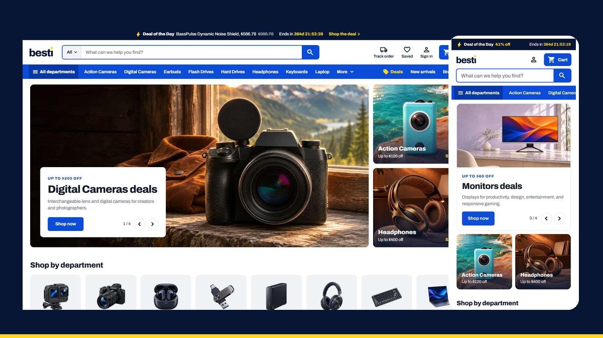
</p>

<h1 align="center">Argon Electronics</h1>

<p align="center">
  <b>A bright, busy, friendly catalogue store for a Selldone electronics shop.</b><br>
  A custom Selldone Layout built on the official <a href="https://github.com/selldone/storefront">selldone/storefront</a>.
</p>

<p align="center">
  <a href="https://argon.selldone.shop"></a>
  <a href="https://github.com/selldone-custom-layouts/official-argon/wiki"></a>
  <a href="https://github.com/selldone-custom-layouts/official-argon/wiki/Install-with-AI"></a>
  
  
</p>

<p align="center">
  <a href="https://argon.selldone.shop"><b>Open the live shop</b></a> ·
  <a href="https://github.com/selldone-custom-layouts/official-argon/wiki/Install-with-AI">Set it up with AI</a> ·
  <a href="https://github.com/selldone-custom-layouts/official-argon/wiki/Manual-Setup">Manual setup</a> ·
  <a href="https://github.com/selldone-custom-layouts/official-argon/wiki/Shop-Requirements">What your shop needs</a> ·
  <a href="https://github.com/selldone-custom-layouts">All Selldone custom layouts</a>
</p>

---

## What it is

**Argon Electronics** dresses a single-shop electronics store as a bright, busy, friendly catalogue retailer. The page sections follow a big catalogue store's; the brand, words and photos are Argon's own.

- a white page with light-grey (`#f2f2f2`) section grounds;
- two colours: **red** `#c8102e` for the brand (the logo tile, links, accents, the deal badge) and **green** `#007a3d` for buying (every Add to cart, Checkout and chosen state);
- near-black pills for quick links, sale red for "Save $X";
- Barlow type and Material Symbols Rounded icons;
- flat buttons, hover changes the colour only, no line under any word or icon, selection rings inside the box;
- a **Theme** button at the top right of the header on Argon's own showcase shop: five palettes (Argon, Cobalt, Plum, Teal, Tangerine), a **Custom colour** and Light / Dark. One click changes the whole site, Selldone's own parts too, and the choice stays in the browser.

It runs on **[argon.selldone.shop](https://argon.selldone.shop)**, one address of the Selldone shop Digini. Selldone lets each domain of a shop carry its own Layout.

Selldone's own cart, checkout, payments and orders keep working underneath. Nothing about the shop is hard-coded except the brand name (one line) and the photos: the category photos are matched by the category's slug (a collage of the category's products stands in when one is missing), and the other photo slots show a named placeholder until their file is added.

## Screenshots

| Desktop | Phone |
| --- | --- |
| 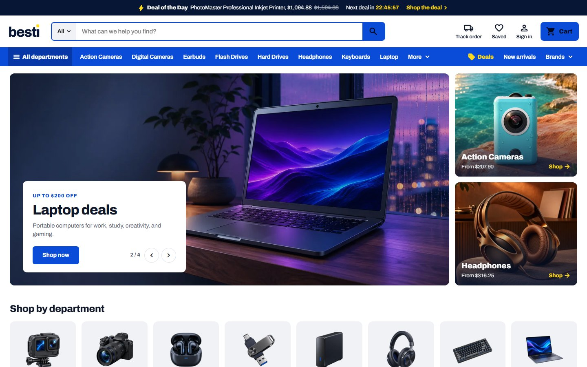 | 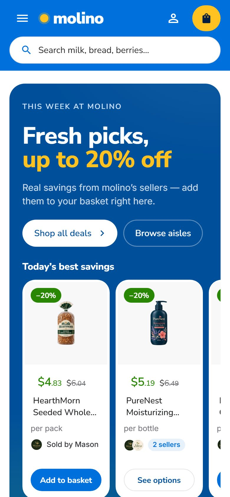 |
| 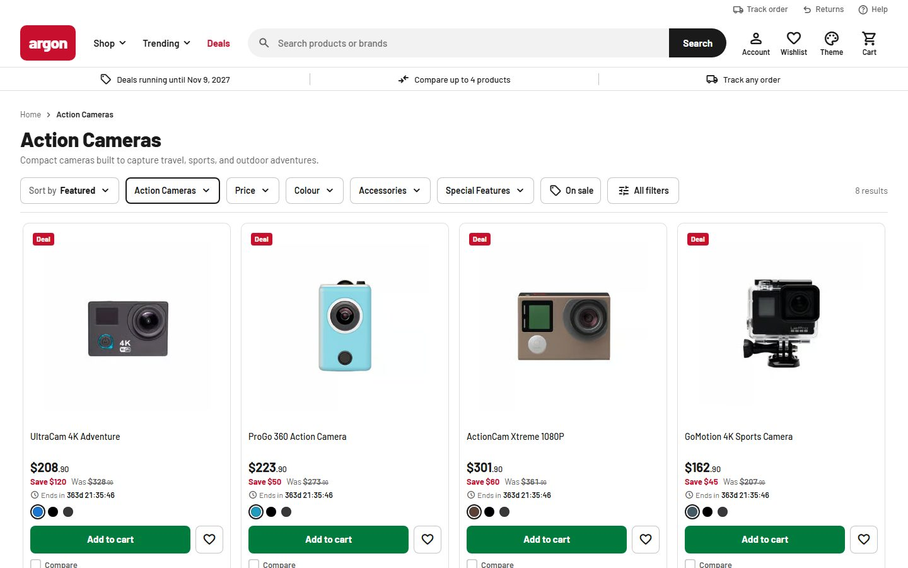 | 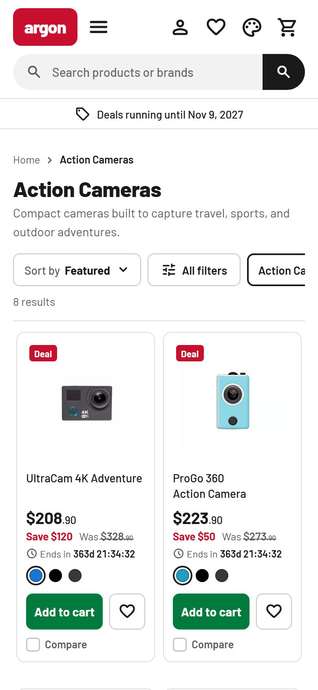 |
| 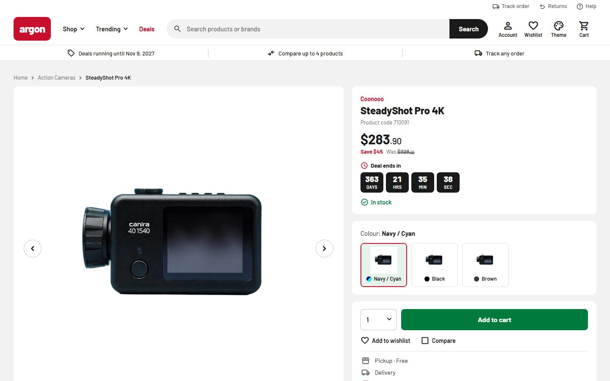 | 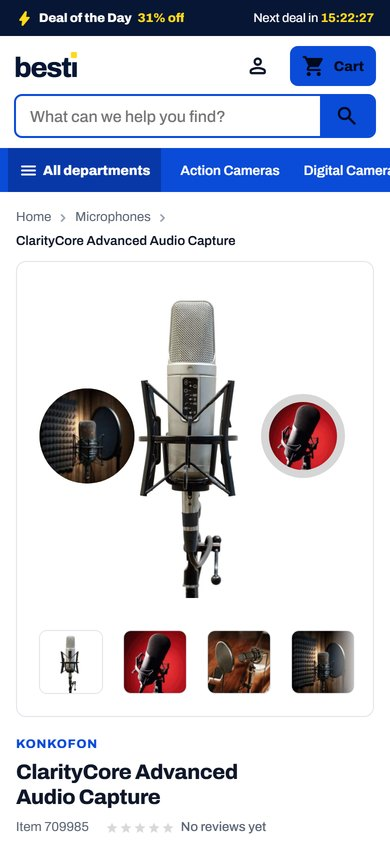 |
| 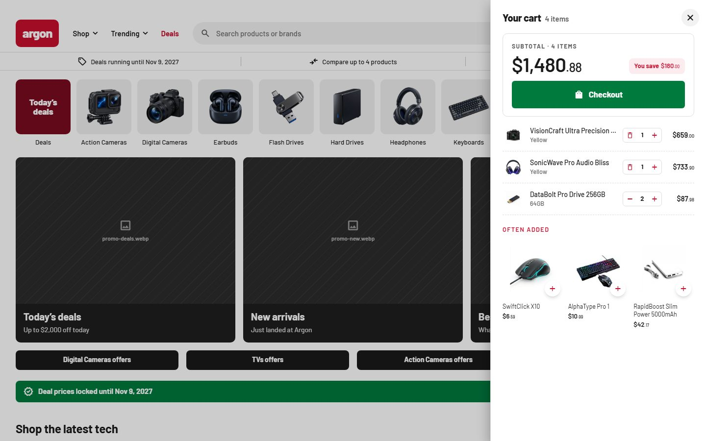 | 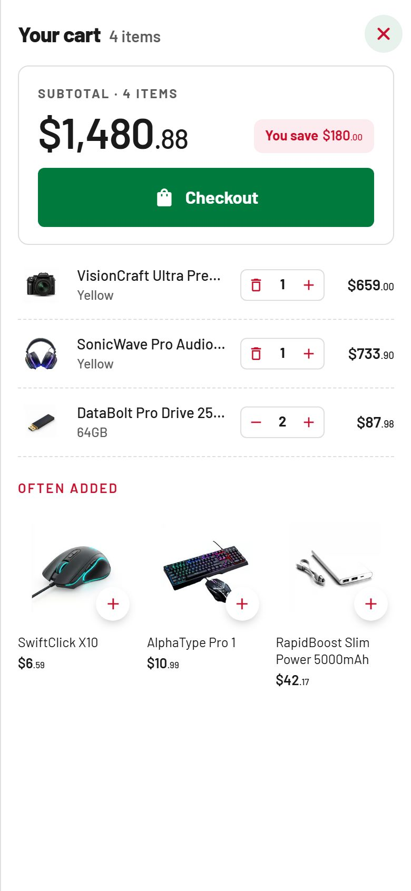 |

| The Theme panel | Dark mode |
| --- | --- |
| 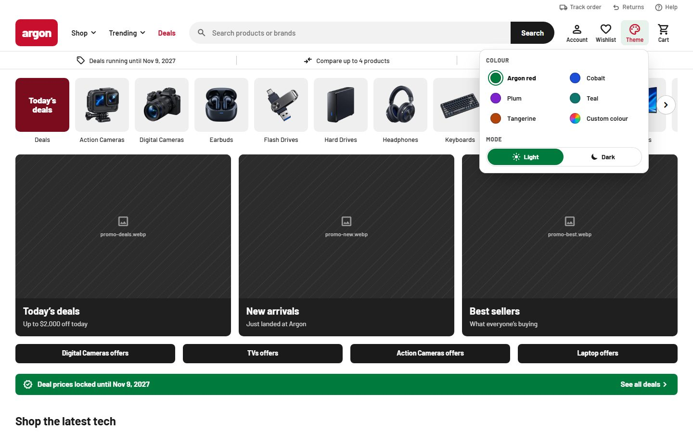 | 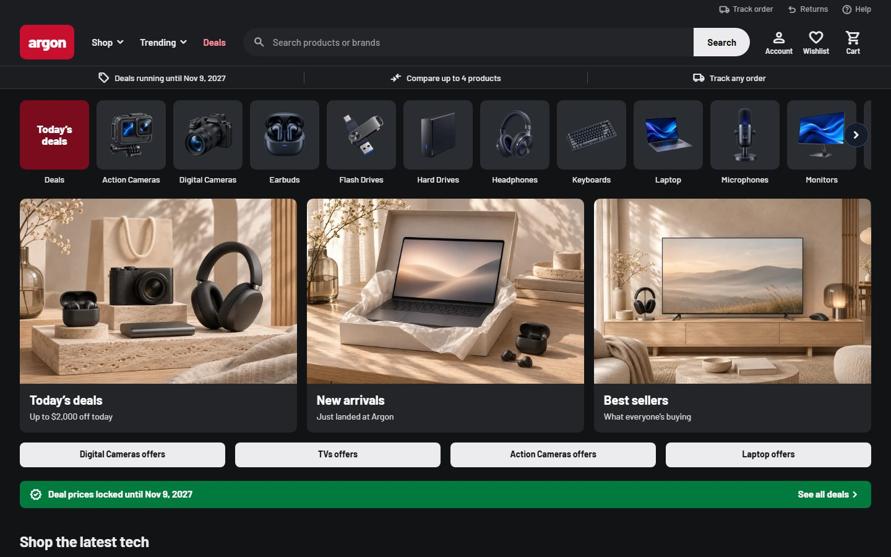 |

## Highlights

- **Header:** a thin utility row (Track order, Returns, Help); the red logo tile; "Shop" (a mega menu of every category with its picture) and "Trending" (the shop's live tags) dropdowns, Deals; a wide rounded grey search with a dark Search button and suggestions while typing; Account, Wishlist, Theme and Cart, each an icon with a small label, the cart with a count bubble. Under it a strip of three links: the deals' real end date, Compare up to 4, Track any order. On a phone: the logo and a menu button, four icons, the search across the screen, and one benefit line that changes every few seconds; the menu button opens a side panel. There is no bottom tab bar.
- **Home:** a category carousel (a "Today's deals" tile, then every category on a grey tile with its packshot); three dark promo cards (Today's deals, New arrivals, Best sellers) and "<Category> offers" pills; a green "Deal prices locked until <date>" strip; **Shop the latest tech** photo cards; a wide "Up to X% off <Category>" banner; **Popular products**; a dark red compare band; **Trending now** (one card per tag); **Explore our brands**; **There's even more** (track, compare, help, contact); **More deals**; **Need a hand?**; the four newest **Tips and guides**; then a short text about the shop with Read more.
- **Cards:** one white card everywhere: the photo with Deal, New and Best seller badges and a heart, a two-line name, the price ("From $X" when the price depends on a choice), a red "Save $X" and "Was", the deal's clock, colour swatches or capacity chips, a full-width green **Add to cart** that turns into "− n +" in place, "Choose options" for a quick-buy sheet, Compare.
- **Results page (category, search, deals, all products):** crumbs, "Results for '…' in …", a big title; a row of dropdowns (Sort by, Category, Price, Brands, Colour, the category's spec filters, On sale) and **All filters** (a side sheet with every filter and Show results); the result count; four cards to a row, two on a phone, no side column.
- **Product page:** two columns on a grey ground. Left: a white gallery card (arrows, a "1/8" counter, zoom, the thumbnails in one row), then About this product, Specifications, Delivery and returns, Reviews. Right: stacked white cards that stay in view: name, product code, price, Save and Was, the deal's clock; "Colour: <name>" tiles; a quantity menu and a big green Add to cart, Add to wishlist, Compare; **Complete your purchase with…**. Then Customers also viewed and More in <category>.
- **Compare:** the picks pinned on top, specs side by side, differences marked, "Only differences".
- **Cart:** a receipt-first drawer (subtotal, savings, Checkout, compact rows, "Often added"), a cart page, a map-first address sheet, delivery method and the payment window.
- **Orders and account:** receipt, delivery and messages with the Argon mark; the account as a **desk** (side menu, order cards, address book).
- **Pages:** guides and articles, About, Terms, Privacy (sample text marked as such until the shop writes its own), Contact us with a form, FAQ and a designed 404.
- **Footer:** Help, Shop, Account and About columns, a "Deals in your inbox" sign-up with the shop's social links, and a legal row with the logo, language and currency pickers and Selldone's cookie settings.

## Theme and colours

Argon runs the shared theme switcher (`components/theme-switcher/`, the same code as the other custom Layouts). On your own shop the visitor switcher is hidden, and Argon shows the theme you set in **one file**, [`components/argon/argon-theme.settings.ts`](components/argon/argon-theme.settings.ts): a palette (`argon`, `cobalt`, `plum`, `teal`, `tangerine`) or any brand colour (`brandColor: "#F5C400"`; a light colour keeps dark words on it with `textOnBrand: "auto"`), `light` or `dark`, and whether your visitors get the switcher (`themeSwitcher: "showcase" | "on" | "off"`). Every colour is made readable automatically. The `argon` palette keeps green buy buttons and a red brand; every other palette and any brand colour use one colour for both. An AI agent finds the steps in the "Theme" section of [`AGENTS.md`](AGENTS.md); the wiki page [Theme and colours](https://github.com/selldone-custom-layouts/official-argon/wiki/Theme-and-colours) has the details.

## Use it on your shop

| You want to… | Read |
| --- | --- |
| Let an AI agent (Claude Code, Codex…) set it up for your shop | [Install with AI](https://github.com/selldone-custom-layouts/official-argon/wiki/Install-with-AI) |
| Do it yourself, step by step | [Manual Setup](https://github.com/selldone-custom-layouts/official-argon/wiki/Manual-Setup) |
| Know what data your shop needs for the design to look right | [Shop Requirements](https://github.com/selldone-custom-layouts/official-argon/wiki/Shop-Requirements) |
| Build, upload and verify a release | [Build and Upload](https://github.com/selldone-custom-layouts/official-argon/wiki/Build-and-Upload) |
| Put the Layout live on your shop, or on one domain of it | [Go Live](https://github.com/selldone-custom-layouts/official-argon/wiki/Go-Live) |
| Change the name, photos, sections or pages | [Customize](https://github.com/selldone-custom-layouts/official-argon/wiki/Customize) |
| Change the colours, light or dark, the visitor switcher | [Theme and colours](https://github.com/selldone-custom-layouts/official-argon/wiki/Theme-and-colours) |
| Fix a blank page, a rejected upload or an old version showing | [Troubleshooting](https://github.com/selldone-custom-layouts/official-argon/wiki/Troubleshooting) |

The wiki's source is also in [`docs/wiki/`](docs/wiki/).

## Quick start (developers)

```bash
git clone --recurse-submodules https://github.com/selldone-custom-layouts/official-argon.git
cd official-argon
npm install --force
npm run serve            # dev server on http://localhost:9132
```

Releases:

```bash
LAYOUT_ID=<your Layout id> SELLDONE_CLI_SRC=<cli clone> bash scripts/release.sh <new version> desk
```

Leave `LAYOUT_ID` out on the first upload; use the id printed after it from then on. See [Build and Upload](https://github.com/selldone-custom-layouts/official-argon/wiki/Build-and-Upload).

## Where things are

| Area | Files |
| --- | --- |
| The brand name (one line) and the mark | [`components/kalio/kalio-brand.ts`](components/kalio/kalio-brand.ts), [`assets/brand/argon-mark.svg`](assets/brand/argon-mark.svg) |
| Your theme (palette, brand colour, mode, switcher) | [`components/argon/argon-theme.settings.ts`](components/argon/argon-theme.settings.ts) |
| Header and footer | [`components/argon/shell/`](components/argon/shell/) |
| Home, card, rails | [`components/argon/`](components/argon/) (`ArgonHome.vue`, `ArgonCard.vue`, `argon-buy.ts`, `argon.ts`) |
| Results page top and filter row | [`components/argon/shop/`](components/argon/shop/) |
| Product page | [`components/argon/product/`](components/argon/product/), [`pages/product/`](pages/product/) |
| Photo slots and their files | [`components/argon/argon-photos.ts`](components/argon/argon-photos.ts), [`assets/photos/`](assets/photos/) |
| Category photos (by category slug) | [`assets/argon/`](assets/argon/) |
| Argon's colour tokens and dress | [`style/argon-theme.scss`](style/argon-theme.scss), [`style/argon.scss`](style/argon.scss), [`style/argon-pages.scss`](style/argon-pages.scss) |
| What Argon is, and its data rules | [`ARGON.md`](ARGON.md) |
| The behaviours it keeps (cart, checkout, account…) | [`components/kalio/`](components/kalio/), [`KALIO.md`](KALIO.md) |
| Release tooling | [`scripts/`](scripts/) |
| Selldone storefront's original README | [`README.selldone.md`](README.selldone.md) |

Argon started from [Besti Electronics](https://github.com/selldone-custom-layouts/official-besti) and keeps its shared parts (classes `k-`, `t-`, `w-`, the theme switcher, the compare page, the cart drawer, the desk account). Argon's own classes are `ar-`.

## Credits and license

Built on the official [Selldone Storefront](https://github.com/selldone/storefront) (MIT License, © Selldone); see [`LICENSE.md`](LICENSE.md). Part of **[Selldone Custom Layouts](https://github.com/selldone-custom-layouts)**.
